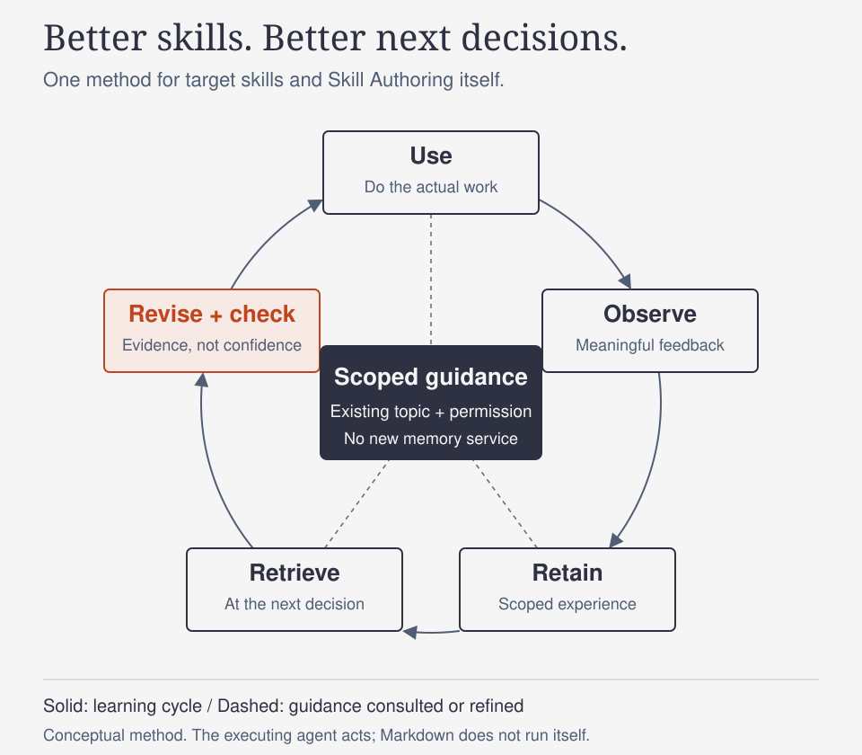

<div align="center">

# Skill Authoring

**让技能具备判断力、保留完整能力，并从真实工作中学习。**

[English](README.md) | 简体中文

[快速开始](#quick-start) · [交给 AI 使用](#use-with-an-ai) · [工作原理](#how-it-works) · [深入指南](#guides)



手机阅读细节时可[打开原尺寸信息图](assets/learning-loop.svg)。

**v6.3.0 · Markdown 技能 · MIT**

</div>

Skill Authoring（SA）是一套可复用的 Agent 指导文档，用于创建、修订、评估或导入技能，审核指定技能集合，以及改进 `AGENTS.md` 等指令文件。它帮助你判断哪些指导值得保留，并检查改动是否真正服务于任务。

它**不是 Agent 运行时、CLI 安装器、记忆服务或自主优化守护进程**。Agent 读取 Markdown，利用已有工具和权限完成工作。图中表达的是方法，不是运行截图或自动执行流水线。

<a id="quick-start"></a>
## 快速开始

### 1. 获取本地副本

克隆需要 Git；使用需要能够读取本地 Markdown 的 Agent；只有可选的离线文档检查需要 Python 3.9+。SA 本身不要求 API 密钥、安装依赖包或启动后台进程。以下命令使用 `python3`；Windows 可使用已安装的 Python 启动器，例如 `py -3`。

在允许创建 `skill-authoring` 新目录的父目录中运行；该目录必须尚不存在：

```sh
git clone https://github.com/Loveacup/skill-authoring.git
cd skill-authoring
python3 scripts/check.py
```

检查成功会输出 `PASS`、版本号和本地链接数量；失败会输出诊断并以非零状态退出。它检查随库 Markdown 链接与锚点、版本一致性及 SVG 结构，不访问网络、不安装技能，也不证明 Agent 的实际行为。

### 2. 不改 Agent 配置，先试用

打开能够访问此 checkout 的 Agent 会话，发送：

```text
读取此 skill-authoring checkout 中的 SKILL.md，再读取与编写和评估相关的参考文档。
帮我设计一个用于检查 CSV 导出的可复用技能。只在当前对话中给出草稿：保留快速检查
和详细验证两种模式，并明确实际反馈来源、获准的经验存储位置，以及下次使用时的
检索线索。不要创建、安装、发布或部署文件。标明假设路径和未经验证的行为。
```

首个有用结果应是一份可检查的技能草稿：触发条件准确，保留两种模式，有具备权限边界的学习闭环，并说明验证限度。这是**文档起草练习**，不是已执行的 CSV 验证器。如果 Agent 不能访问本地文件，请显式提供 `SKILL.md` 和相关参考正文，不要假定它已经抓取链接。

### 3. 需要原生发现时再安装

SA 不提供安装器，也不假定所有宿主使用同一技能目录。让 Agent 先查明当前宿主有文档依据的技能加载机制，检查是否已有 `skill-authoring`，并在写入前提出确切目标。安装时保留**完整技能载荷：`SKILL.md` 与 `references/`**及其相对布局。README、许可、来源说明和图片可以随 checkout 保留；检查脚本用于仓库维护，不是运行时依赖。

获准替换既有入口前，保留本地适配并备份。打开新会话，确认宿主发现正确入口、读取相关参考，再执行一个有边界的任务。文件复制或哈希相同只能证明放置正确，不能证明实际使用成功。发现、安装、更新及回退详见 [AI 配置指南](docs/AI_SETUP.zh-CN.md)。

<a id="use-with-an-ai"></a>
## 交给 AI 使用

让 Agent 协助安装时，复制以下请求，并说明宿主及获准工作目录：

```text
读取 Loveacup/skill-authoring 的 README.zh-CN.md 和 docs/AI_SETUP.zh-CN.md。
检查此 checkout 及我指定 Agent 宿主的真实加载机制。提出目标位置前，发现已有 SA
入口及其维护来源。只在我授权的工作目录准备，保留无关设置和本地适配。不要发明
安装器或配置文件。除非我已明确授权这个确切目标，否则安装或重定向前先征求批准。
获准安装后，检查发现、参考加载和一个有边界的任务，区分文件放置与实际使用。
不要发布私有经验。
```

技能可访问后，直接用自然语言提出请求；不要求特定斜杠命令语法：

| 目标 | 请求示例 |
|---|---|
| 创建可复用技能 | “用 SA 起草研究技能，同时支持简短回答和完整带引用报告。” |
| 修复已有技能 | “检查这个技能和失败产物，修复导致问题的指导，不删除其他模式。” |
| 增加使用中学习 | “在维护权限内，将经过验证的纠正连接到此技能已有主题笔记和下次检索线索。” |
| 审核技能集合 | “只审核这五个描述的任务冲突，提出建议，不写文件。” |
| 改进 Agent 指令 | “审核此 AGENTS.md 的冲突要求和不必要的常驻步骤，保留强制测试。” |
| 对齐不同副本 | “比较维护源与已安装副本，区分可移植改动和私有宿主适配后再提出合并。” |

只读任务的发现和候选修订留在获准报告中。提及学习不等于授权修改文件、采集额外数据或部署。

<a id="how-it-works"></a>
## 工作原理

**提供判断依据，而不是通用步骤清单。** 小型入口仅在任务需要时引导读取专业知识。精确接口和真实安全边界保持具体，普通推理与工具选择交给 Agent。

**先保能力，再做精简。** 确认已有技能必须持续交付什么，再改进指导，不能默默删除深入模式或有用保护。验证用于消除重要不确定性，不以固定测试数量或篇幅作为质量门槛。

**双向学习。** SA 让目标技能能够在自己的使用过程中学习，也通过编写反馈和目标后续结果改进自身方法。有意义的信号成为限定范围的经验；检索线索让经验进入下次相关决策；局部修订通过真实结果检查。模型自评分高不代表候选可以直接采用。经验可以被纠正、合并或撤回。

**各类动作分别授权。** 准备、应用到规范副本、运行时部署、公开发布与退役是不同状态。一个状态不会自动授权或证明另一个。Markdown 指导不是执行器沙箱。

<a id="guides"></a>
## 找到合适的指南

技能正文与详细参考为英文；README 和安装使用指南均提供完整英中版本。

| 需要 | 阅读 |
|---|---|
| AI 协助配置与更新 | [中文配置指南](docs/AI_SETUP.zh-CN.md) / [English](docs/AI_SETUP.md) |
| 找到技能入口 | [SKILL.md](SKILL.md)（英文） |
| 设计或实质修订技能 | [Author](references/author.md)（英文） |
| 构建或运行学习闭环 | [Experience-driven evolution](references/evolution.md)（英文） |
| 诊断失败或比较行为 | [Evaluate](references/evaluate.md)（英文） |
| 审核指定集合或指令文件 | [Collection governance](references/collection-governance.md) / [Agent instructions](references/agent-instructions.md)（英文） |
| 对齐副本与所有权 | [Import](references/import.md) / [可选本地适配](references/skillhub.md)（英文） |
| 发布、部署或退役产物 | [Release](references/release.md) / [Privacy](references/privacy.md)（英文） |
| 理解维护契约与历史 | [核心需求](references/core-requirements.md) / [变更记录](references/changelog.md) / [研究说明](references/research-notes.md)（英文） |

## 验证与局限

在干净 checkout 中运行 `python3 scripts/check.py`。检查器支持本库使用的行内链接、HTML 链接与图片，以及 GitHub 风格标题锚点；遇到引用式链接定义会明确拒绝，避免不支持的语法被静默跳过。它不是完整 Markdown 渲染器、外链监控器或秘密扫描器。

v6.3.0 候选经过独立新上下文的文档审查，以及有边界的虚构技能起草试用，详见 [变更记录](references/changelog.md)。这些观察不能证明所有宿主兼容、无人值守捕获、跨模型增益或长期学习收益。必须在实际安装宿主上检查原生发现与真实任务验收。引用研究是设计背景，不是安装依赖或性能保证。

## 贡献

通过 [Issues](https://github.com/Loveacup/skill-authoring/issues) 提供可复现缺陷或建议。行为修改前阅读 [核心需求](references/core-requirements.md)，采用最小但完整的修订，按需更新已有变更记录，并运行离线检查。同步维护两版 README 与配置指南。行为主张应附实际限定任务和结果，而非仅有自评分。示例需要脱敏，不要提交私有对话、凭据、宿主绑定或审计日志。

## 来源与许可

维护源为 [Loveacup/skill-authoring](https://github.com/Loveacup/skill-authoring)，从 [Loveacup/jz-skills](https://github.com/Loveacup/jz-skills) 的 `shared/skill-authoring` 技能族独立而来。保留原始 `author: Hermes Agent` 元数据与历史来源归属。抽取边界及早期历史见 [PROVENANCE.md](PROVENANCE.md)（英文）。

采用 [MIT License](LICENSE)。参考文档引用的外部作品保留各自许可；引用不代表将其实现纳入本项目。
